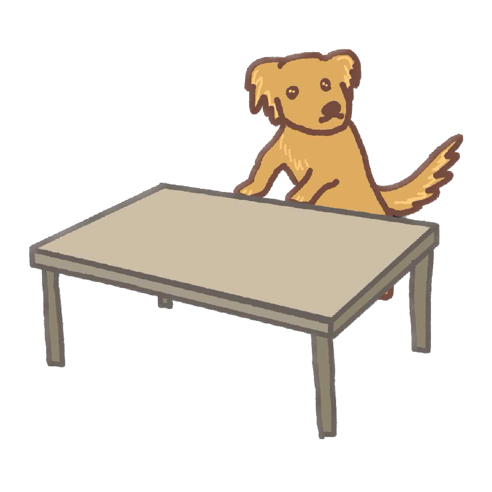
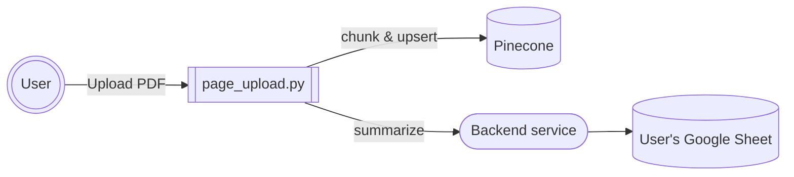
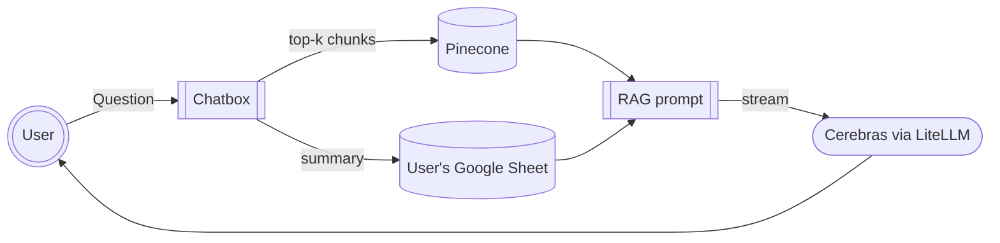

<div id="top">

<div align="center">



# EASYESSAY

<em>A RAG-based literature review system with decentralized, user-owned storage.</em>


</div>
<br>

## Overview

EasyEssay turns a pile of papers into something you can query. Upload a PDF, get a structured summary, and chat with the document using retrieval-augmented generation (RAG) so answers stay grounded in the source text.

- **Literature management:** organize documents with tags and languages.
- **RAG chat:** ask questions against a document's summary plus the most relevant retrieved passages, with the prompt constrained to the provided material.
- **Model choice:** `gpt-oss-120b` or `llama-3.3-70b`, served by Cerebras.
- **Decentralized storage:** every user keeps their own data in their own Google Sheet. Only a minimal user registry is stored centrally.

## Tech Stack

| Aspect | Technology |
| --- | --- |
| Frontend | [Streamlit](https://streamlit.io/) |
| Summarization / upsert backend | [Render](https://render.com/) (`easyessaybackend`) |
| Vector database | [Pinecone](https://www.pinecone.io/) |
| Database | Google Sheets (per user) |
| LLM provider | [Cerebras](https://cloud.cerebras.ai/) via [LiteLLM](https://github.com/BerriAI/litellm) |
| Package management | [uv](https://docs.astral.sh/uv/) |

## Architecture

### Decentralized storage

Each user registers with a publicly editable Google Sheet URL. On registration the app creates three worksheets in it: `user_docs`, `user_tags` and `user_chats`. A single central sheet only holds the user registry (`user_info`: username, user id, email, SHA-256 password hash, register time, database URL).

Document ids look like `{user_id}-{random_8_chars}` and double as the Pinecone namespace, so each document's vectors are isolated.

### Literature upload



### Chat with literature



## Getting Started

### Prerequisites

- [uv](https://docs.astral.sh/uv/getting-started/installation/)
- API keys for Cerebras and Pinecone (and Gemini if you use the legacy summarizer)
- A Google service account with access to the sheets you use

### Install

```bash
uv sync
```

uv creates `.venv` with the Python version in `.python-version` and installs the locked dependencies.

### Configure

Create `.streamlit/secrets.toml`:

```toml
[permission]
guest_mode = true

[credits]
GEMINI_KEY = "..."
CEREBRAS_API_KEY = "..."
PINECONE = "..."

[gsheet-conn]
credits = '{"type": "service_account", ...}'  # service account JSON as a string

[gsheet-urls]
user = "https://docs.google.com/spreadsheets/d/..."  # central user registry
```

For local development, a `.env` file with `CEREBRAS_API_KEY` and `GEMINI` is read first and takes precedence over `st.secrets`.

### Run

```bash
uv run streamlit run index.py
```

## Managing dependencies

```bash
uv add <package>      # add a dependency
uv remove <package>   # remove a dependency
uv lock --upgrade     # upgrade the lockfile
uv sync               # sync .venv with the lockfile
```

## Project structure

| Path | Role |
| --- | --- |
| `index.py` | Entry point and login page |
| `pages/` | Streamlit pages: upload, docs, chat, account |
| `utils/sheet_manager.py` | Google Sheets CRUD, locking, schema setup |
| `utils/docs_manager.py` | Pinecone operations |
| `utils/llm_manager.py` | `ChatBot` (RAG chat); `Summarizor` is deprecated |
| `utils/prompt_manager.py` | Prompt templates |
| `utils/user_manager.py` | Login, registration, account deletion |
| `utils/data_manager.py` | PDF loading, parsing helpers, id generation |
| `utils/ui_manager.py` | Sidebar and demo embeds |
| `utils/constants.py` | Model list and static snippets |

`managers.py` is a legacy monolithic version of the `utils/` modules and is not imported by the app.
